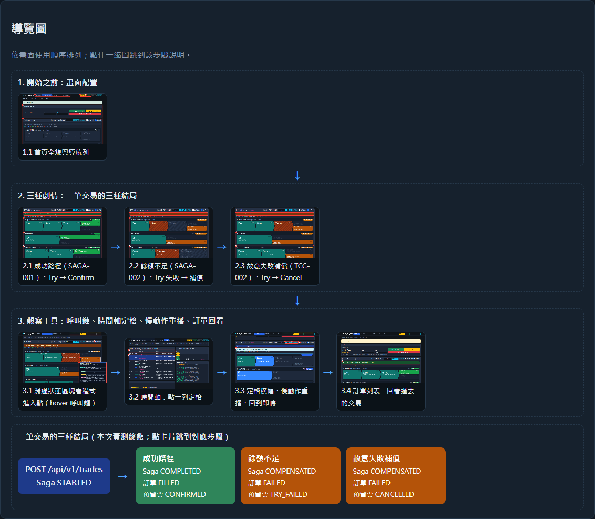
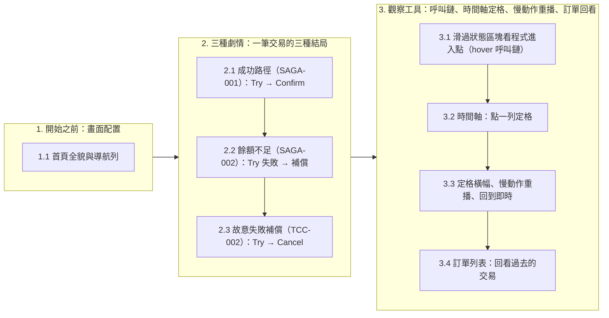
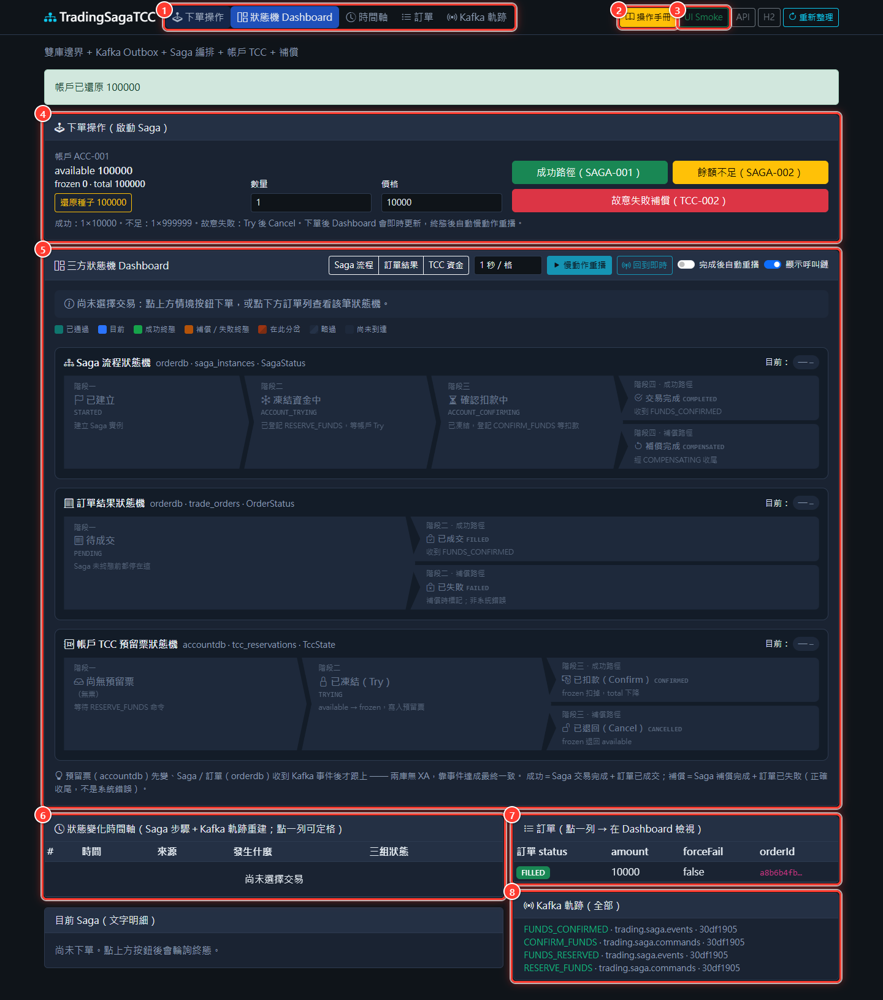
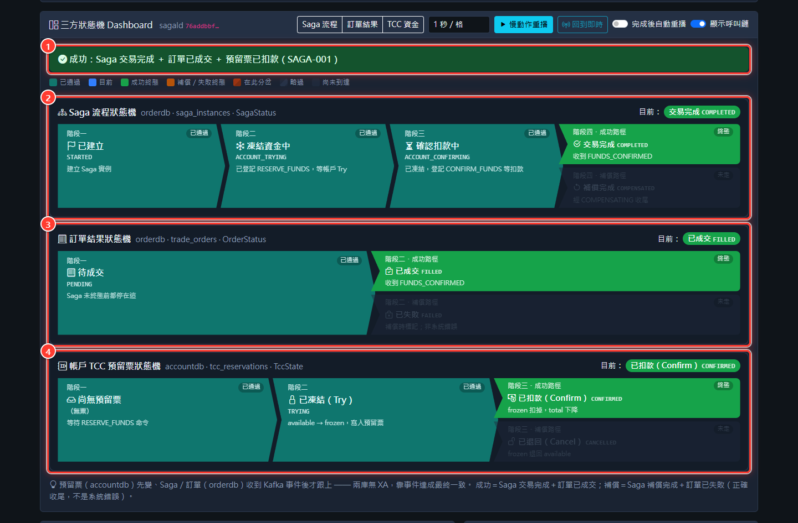
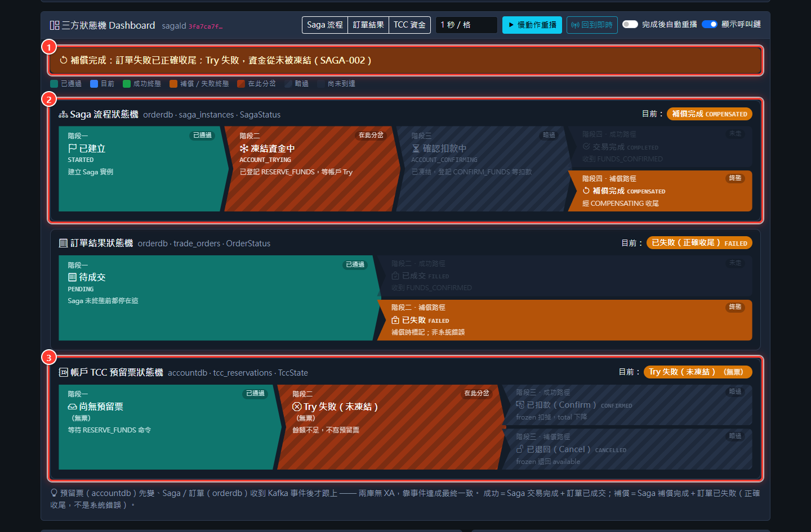
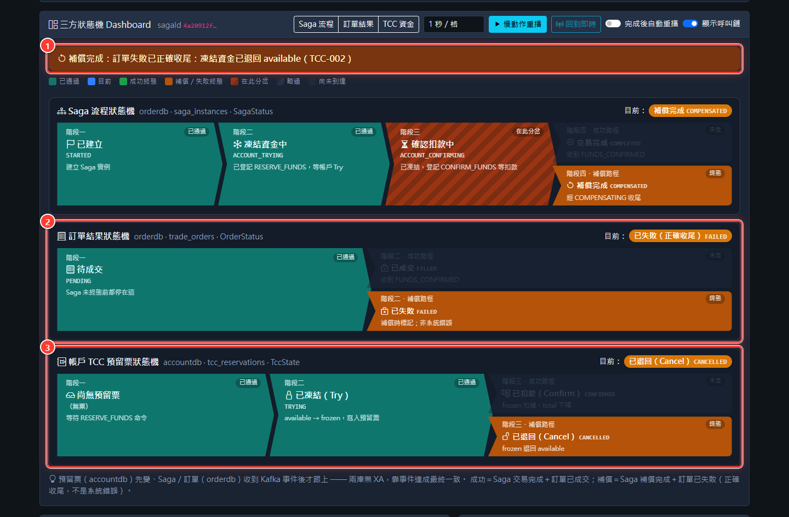
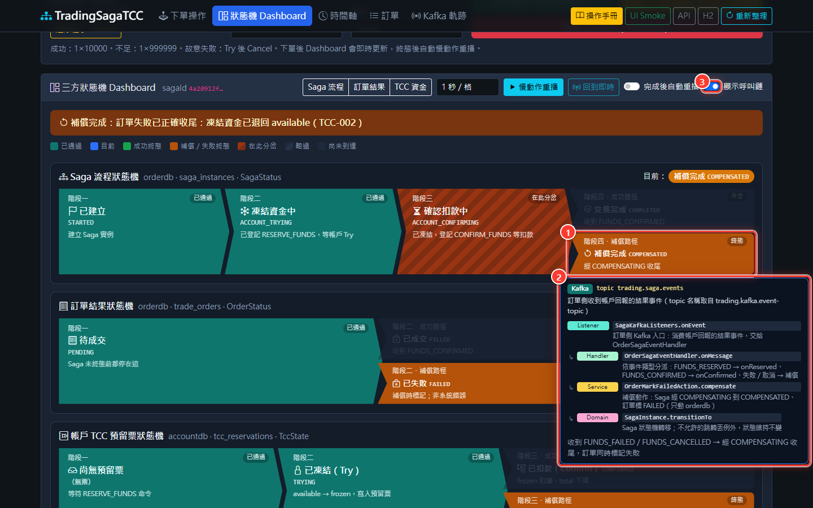
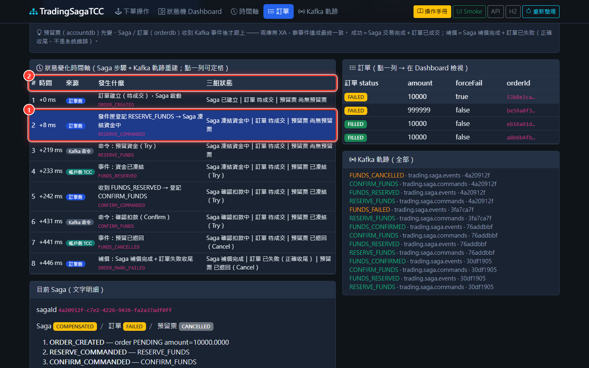
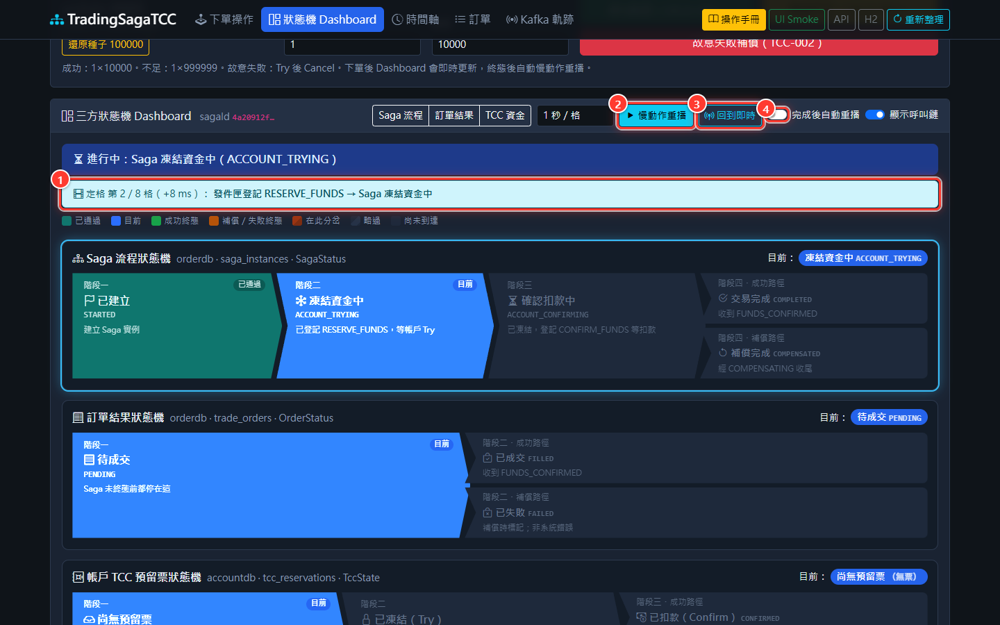
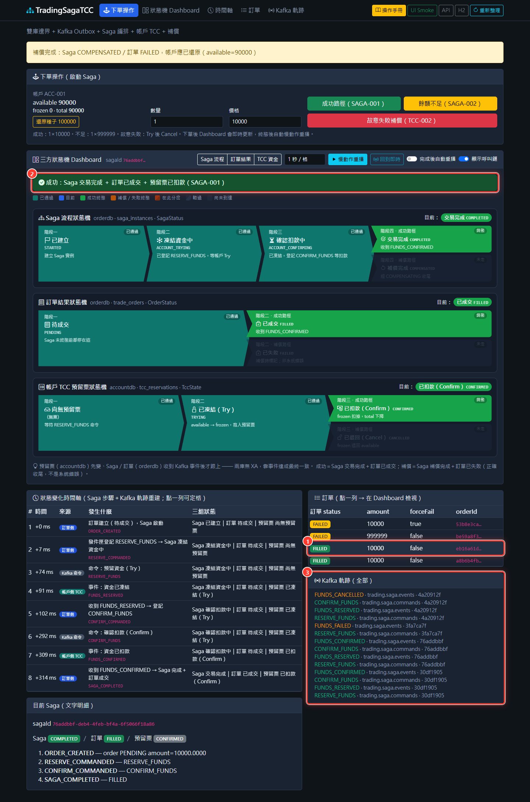

# TradingSagaTCC 操作手冊

> 一頁式 Dashboard：下單啟動 Saga → 三條狀態機看結局 → 重播／呼叫鏈／訂單回看（自動截圖產生）

產生時間 2026/10/15 10:09:29 · 環境 `http://localhost:8093` · 由 `docs/run-manual.ps1` 自動截圖產生（HTML 版：[操作手冊.html](操作手冊.html)）

## 前置條件

| 項目 | 值 | 說明 |
|------|----|------|
| 帳戶 | `ACC-001` | 種子 available 100000；每輪 Demo 前按「還原種子 100000」 |
| 網址 | `http://localhost:8093/` | Gradle `bootRun` 後開啟（內嵌 Kafka，不必 Docker） |
| 自動重播 | `?autoReplay=0` | 截圖時關閉「完成後自動重播」，畫面才會停在終態 |

## 導覽圖

**三種結局（本次實測終態）**

| 劇情 | Saga | 訂單 | 預留票 | 步驟 |
|------|------|------|--------|------|
| 成功路徑 | `COMPLETED` | `FILLED` | `CONFIRMED` | [2.1](#21-成功路徑saga-001try--confirm) |
| 餘額不足 | `COMPENSATED` | `FAILED` | `TRY_FAILED` | [2.2](#22-餘額不足saga-002try-失敗--補償) |
| 故意失敗補償 | `COMPENSATED` | `FAILED` | `CANCELLED` | [2.3](#23-故意失敗補償tcc-002try--cancel) |

## 目錄

1. 開始之前：畫面配置
   - [1.1 首頁全貌與導航列](#11-首頁全貌與導航列)
2. 三種劇情：一筆交易的三種結局
   - [2.1 成功路徑（SAGA-001）：Try → Confirm](#21-成功路徑saga-001try--confirm)
   - [2.2 餘額不足（SAGA-002）：Try 失敗 → 補償](#22-餘額不足saga-002try-失敗--補償)
   - [2.3 故意失敗補償（TCC-002）：Try → Cancel](#23-故意失敗補償tcc-002try--cancel)
3. 觀察工具：呼叫鏈、時間軸定格、慢動作重播、訂單回看
   - [3.1 滑過狀態區塊看程式進入點（hover 呼叫鏈）](#31-滑過狀態區塊看程式進入點hover-呼叫鏈)
   - [3.2 時間軸：點一列定格](#32-時間軸點一列定格)
   - [3.3 定格橫幅、慢動作重播、回到即時](#33-定格橫幅慢動作重播回到即時)
   - [3.4 訂單列表：回看過去的交易](#34-訂單列表回看過去的交易)

## 1. 開始之前：畫面配置

### 1.1 首頁全貌與導航列

整個系統只有一頁：上面下單、中間看三條狀態機、下面看時間軸與訊息。先還原帳戶，讓 available 回到種子 100000。

**畫面標註**

① 導航列：下單操作／狀態機 Dashboard／時間軸／訂單／Kafka 軌跡，點了平滑捲到該區塊  
② 操作手冊：新分頁開啟本手冊，邊看邊操作  
③ UI Smoke：瀏覽器內跑 DASH-002～004 自動驗收（會真的下單）  
④ 下單操作：帳戶餘額、還原種子、三顆劇情按鈕  
⑤ 三方狀態機 Dashboard：Saga 流程／訂單結果／TCC 資金三條 lane  
⑥ 狀態變化時間軸：Saga 步驟＋Kafka 訊息重建，點一列可定格  
⑦ 訂單列表：點一列在 Dashboard 回看那筆交易  
⑧ Kafka 軌跡：所有指令與事件訊息  

**操作步驟**

1. 開啟 http://localhost:8093/
2. 按「還原種子 100000」
3. 需要對照步驟時點導航列「操作手冊」（新分頁）

**預期結果**：頂部出現「帳戶已還原 100000」，available＝100000；Dashboard 總結列顯示「尚未選擇交易」。

**API**：`POST /api/v1/accounts/ACC-001/reset、GET /api/v1/demo/state`　**驗收案例**：`ACCOUNT-001` `DASH-001`

背後程式（hover 呼叫鏈 <code>action:reset</code>）

把種子帳戶還原為 available=100000、frozen=0

- **入口** `HTTP POST /api/v1/accounts/{accountId}/reset` — 前台按「還原種子 100000」：重置 Demo 帳戶餘額
  1. `AccountController.reset` — Demo 重置 API：交給 AccountQueryService 還原種子帳戶
  2. `AccountQueryService.reset` — accountdb 交易內重置帳戶餘額
  3. `Account.resetTo` — 直接設定 available／frozen（Demo／測試用）

## 2. 三種劇情：一筆交易的三種結局

### 2.1 成功路徑（SAGA-001）：Try → Confirm

正常買入：帳戶先凍結金額（Try），Saga 收到 FUNDS_RESERVED 後下 Confirm 扣款，訂單成交。兩個資料庫沒有 XA，靠 Kafka 事件最終一致。

**畫面標註**

① 總結列（綠）：Saga `COMPLETED`／訂單 `FILLED`／預留票 `CONFIRMED`  
② Saga 流程：STARTED → ACCOUNT_TRYING → ACCOUNT_CONFIRMING → COMPLETED  
③ 訂單結果：PENDING → FILLED（orderdb）  
④ 預留票：TRYING → CONFIRMED（accountdb，Try 凍結、Confirm 扣款）  

**操作步驟**

1. 數量 1、價格 10000（預設值）
2. 按綠色「成功路徑（SAGA-001）」
3. 等頂部提示變綠

**預期結果**：Saga `COMPLETED`／訂單 `FILLED`／預留票 `CONFIRMED`；available 100000 → 90000（扣 10000）。

**API**：`POST /api/v1/trades（202＋sagaId）→ 輪詢 GET /api/v1/sagas/{sagaId}`　**驗收案例**：`SAGA-001` `OUTBOX-001` `TCC-001` `DASH-002`

背後程式（hover 呼叫鏈 <code>action:place</code>）

只負責「啟動」：建立訂單＋Saga、RESERVE_FUNDS 進發件匣，HTTP 202 立即返回；之後全靠 Kafka 推進

- **入口** `HTTP POST /api/v1/trades` — 前台按 SAGA-001／SAGA-002／TCC-002 任一顆下單鈕：只啟動 Saga，HTTP 202 立即返回
  1. `TradeController.place` — 接收下單請求：@Valid 驗證後交給 SagaOrchestrator，回 202 Accepted
  2. `SagaOrchestrator.start` — orderdb 同一 Local TX：建訂單＋Saga 實例 → 轉 ACCOUNT_TRYING → RESERVE_FUNDS 寫進發件匣
  3. `OutboxPublisherService.append` — 把命令寫進發件匣（outbox 表），與業務資料同一個 TX

### 2.2 餘額不足（SAGA-002）：Try 失敗 → 補償

用 999999 的價格下單：帳戶 Try 失敗回 FUNDS_FAILED，Saga 把訂單標記失敗收尾。補償完成是「正確結局」，不是系統錯誤。

**畫面標註**

① 總結列（橘）：Saga `COMPENSATED`／訂單 `FAILED`／預留票 `TRY_FAILED`  
② Saga 走補償分岔：ACCOUNT_TRYING 之後 → COMPENSATING → COMPENSATED  
③ 預留票：餘額不足，Try 直接失敗、沒有凍結任何金額  

**操作步驟**

1. 按黃色「餘額不足（SAGA-002）」（自動用 1×999999，結束後價格還原 10000）
2. 等頂部提示變橘

**預期結果**：Saga `COMPENSATED`／訂單 `FAILED`／預留票 `TRY_FAILED`；available 維持 90000（沒有被扣）。

**API**：`POST /api/v1/trades → Kafka FUNDS_FAILED → GET /api/v1/sagas/{sagaId}`　**驗收案例**：`SAGA-002` `TCC-001` `DASH-002`

### 2.3 故意失敗補償（TCC-002）：Try → Cancel

forceFail=true：帳戶 Try 成功凍結後故意 Cancel，示範 TCC 的「取消」把凍結金額退回。

**畫面標註**

① 總結列（橘）：Saga `COMPENSATED`／訂單 `FAILED`／預留票 `CANCELLED`  
② 訂單結果：PENDING → FAILED  
③ 預留票：TRYING → CANCELLED（凍結的錢退回 available）  

**操作步驟**

1. 按紅色「故意失敗補償（TCC-002）」
2. 等頂部提示變橘

**預期結果**：Saga `COMPENSATED`／訂單 `FAILED`／預留票 `CANCELLED`；available 回到 90000（Try 凍結後已退回）。

**API**：`POST /api/v1/trades（forceFail=true）→ Kafka FUNDS_CANCELLED`　**驗收案例**：`TCC-002` `TCC-001` `DASH-002`

## 3. 觀察工具：呼叫鏈、時間軸定格、慢動作重播、訂單回看

### 3.1 滑過狀態區塊看程式進入點（hover 呼叫鏈）

想知道「是哪段程式把狀態改成這樣」：滑過區塊即可看到進入點與方法鏈，資料來自 code-trace.json（測試保證與程式碼一致）。

**畫面標註**

① 滑鼠停在「補償完成」區塊（按鈕、時間軸列也都可以）  
② 呼叫鏈：入口（Kafka topic）→ Listener → Handler → Service → 方法，每格附中文說明  
③ 「顯示呼叫鏈」開關：關掉後滑過不再跳提示  

**操作步驟**

1. 確認 Dashboard 右上「顯示呼叫鏈」為開
2. 滑鼠停在任一狀態區塊、劇情按鈕或時間軸列
3. 移開滑鼠或捲動頁面，提示自動收起

**預期結果**：出現深色提示框，第一行是入口（HTTP／Kafka／排程），下面依序列出 Controller／Listener → Service → 方法。

**API**：`GET /code-trace.json`　**驗收案例**：`DASH-004`

背後程式（hover 呼叫鏈 <code>saga:COMPENSATED</code>）

收到 FUNDS_FAILED／FUNDS_CANCELLED → 經 COMPENSATING 收尾，訂單同時標記失敗

- **入口** `KAFKA trading.saga.events` — 訂單側收到帳戶回報的結果事件（topic 名稱取自 trading.kafka.event-topic）
  1. `SagaKafkaListeners.onEvent` — 訂單側 Kafka 入口：消費帳戶回報的結果事件，交給 OrderSagaEventHandler
  2. `OrderSagaEventHandler.onMessage` — 依事件類型分派：FUNDS_RESERVED → onReserved、FUNDS_CONFIRMED → onConfirmed、失敗／取消 → 補償
  3. `OrderMarkFailedAction.compensate` — 補償動作：Saga 經 COMPENSATING 到 COMPENSATED、訂單標 FAILED（只動 orderdb）
  4. `SagaInstance.transitionTo` — Saga 狀態機轉移；不允許的跳轉丟例外，狀態維持不變

### 3.2 時間軸：點一列定格

時間軸把 Saga 步驟與 Kafka 訊息按時間排好；點一列，Dashboard 就停在「那一刻」三條狀態機的樣子。

**畫面標註**

① 被點的列（第 2 格）：發件匣登記 RESERVE_FUNDS → Saga 凍結資金中  
② 欄位：相對時間、來源（訂單／Kafka／帳戶）、發生什麼、當下三組狀態  

**操作步驟**

1. 在 Dashboard 看著一筆交易（預設是最後一筆）
2. 時間軸點任一列

**預期結果**：該列反白；Dashboard 上方出現「定格 第 2／8 格」橫幅。

**API**：`—（前端用 GET /api/v1/demo/state 的 Kafka 軌跡重建）`　**驗收案例**：`DASH-003`

### 3.3 定格橫幅、慢動作重播、回到即時

重播讓你看清楚「預留票先變、Saga／訂單後跟上」的順序：兩個資料庫靠事件追上彼此。

**畫面標註**

① 定格橫幅：目前停在第幾格、相對時間、那一格發生什麼  
② 慢動作重播：從第 1 格逐格播放（旁邊下拉選每格秒數）  
③ 回到即時：離開定格，顯示最新狀態  
④ 完成後自動重播：開著時，每次下單到終態會自動播一遍  

**操作步驟**

1. 按「慢動作重播」觀察三條 lane 逐格亮起
2. 按「回到即時」結束定格

**預期結果**：重播時變動的 lane 會發藍光；播完自動回到即時。

**API**：`—（純前端）`　**驗收案例**：`DASH-003`

### 3.4 訂單列表：回看過去的交易

每一筆交易都能回看：點訂單列，Dashboard、時間軸、文字明細都切到那筆 Saga。

**畫面標註**

① 點的是第一筆成功交易（sagaId 76addbbf…），列反白  
② Dashboard 切回那筆交易：總結列又變綠  
③ Kafka 軌跡：RESERVE_FUNDS／FUNDS_RESERVED／CONFIRM_FUNDS… 依序累積  

**操作步驟**

1. 在「訂單」表點任一列
2. 頁面自動捲回 Dashboard

**預期結果**：Dashboard 顯示 Saga `COMPLETED`／訂單 `FILLED`／預留票 `CONFIRMED`；時間軸換成那筆的步驟。

**API**：`GET /api/v1/sagas/{sagaId}、GET /api/v1/tcc/reservations/{sagaId}`　**驗收案例**：`DASH-003` `TRADE-001`

---

重新產生：先 Gradle `bootRun`（:8093），再 `.\docs\run-manual.ps1`。劇本：`docs/manual/flows.mjs`。sagaId、available 為執行當下的值。
